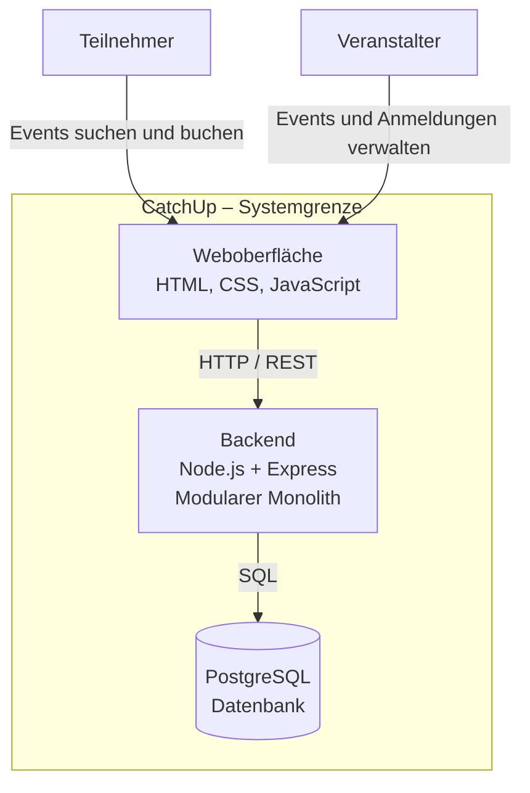
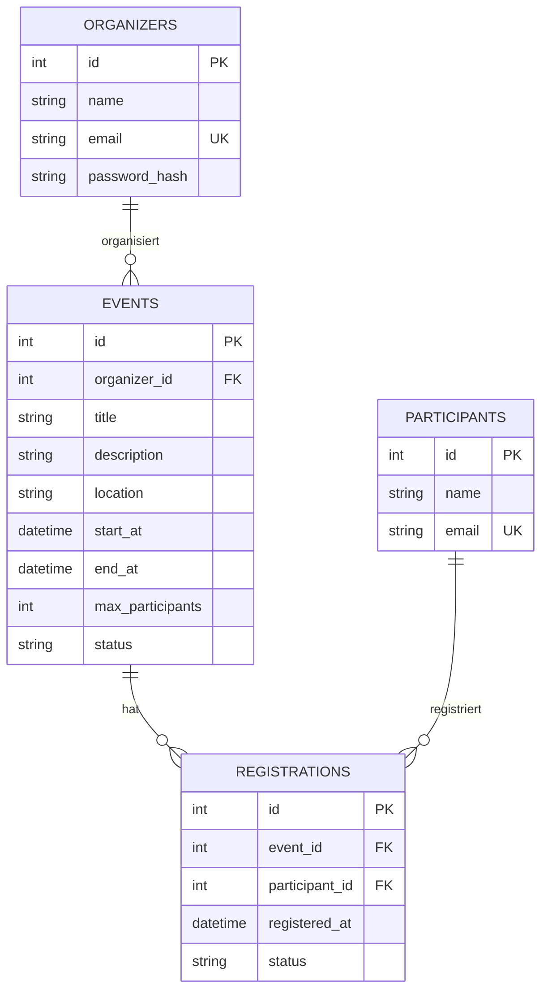

# CatchUp – Softwarearchitektur

## 1. Ziel der Architektur

Ziel ist die Entwicklung einer nachvollziehbaren, wartbaren und realistisch umsetzbaren Softwarearchitektur für die Event-Management-Plattform CatchUp.

Die Plattform soll Veranstaltern ermöglichen, Veranstaltungen zu erstellen, zu bearbeiten und abzusagen sowie Teilnehmeranmeldungen und verfügbare Plätze zu verwalten.

Teilnehmer sollen Veranstaltungen suchen, Details ansehen und sich anmelden können.

Die Architektur soll die Anforderungen eines Semesterprojekts erfüllen und spätere Erweiterungen ermöglichen.

## 2. Anforderungen an die Architektur

Die Architektur muss folgende Funktionen unterstützen:

- Benutzerregistrierung sowie Login und Logout
- Veranstaltungen anzeigen, suchen und filtern
- Veranstaltungsdetails anzeigen
- Veranstaltungen erstellen, bearbeiten und absagen
- Teilnehmer für Veranstaltungen anmelden
- Anmeldungen verwalten und stornieren
- Maximale Teilnehmerzahl kontrollieren
- Doppelanmeldungen und Überbuchungen verhindern
- Rollen und Zugriffsrechte berücksichtigen

Wichtige Qualitätsanforderungen sind:

- Sicherheit und Datenschutz
- Wartbarkeit und Erweiterbarkeit
- Zuverlässige Datenverarbeitung
- Benutzerfreundlichkeit
- Angemessene Entwicklungs- und Hostingkosten

## 3. Architekturvariante A – Monolithische Webanwendung

### Beschreibung

Bei einer monolithischen Architektur werden Benutzeroberfläche, Geschäftslogik und Datenzugriff innerhalb einer gemeinsamen Anwendung entwickelt und bereitgestellt.

Die Anwendung greift auf eine zentrale Datenbank zu.

### Vorteile

- Einfachere Entwicklung und Bereitstellung
- Geringerer Konfigurationsaufwand
- Weniger Kommunikationsschnittstellen
- Gut geeignet für kleine Entwicklungsteams
- Häufig geringere Betriebskomplexität

### Nachteile

- Stärkere Kopplung der Anwendungskomponenten
- Frontend und Backend können nicht unabhängig bereitgestellt werden
- Änderungen können die gesamte Anwendung betreffen
- Bei wachsendem Projektumfang schwieriger zu skalieren

### Bewertung

Diese Variante eignet sich besonders für ein Semesterprojekt mit begrenzter Entwicklungszeit. Durch eine modulare Struktur kann die Wartbarkeit verbessert werden.

## 4. Architekturvariante B – Getrennte Client-Server-Architektur

### Beschreibung

Bei dieser Variante werden Frontend und Backend als getrennte Anwendungen entwickelt.

Das Frontend kommuniziert über eine REST-API mit dem Backend. Das Backend verarbeitet die Geschäftslogik und verwaltet den Datenbankzugriff.

### Vorteile

- Klare Trennung zwischen Benutzeroberfläche und Geschäftslogik
- Frontend und Backend können unabhängig entwickelt werden
- Gute Erweiterbarkeit durch definierte API-Schnittstellen
- Möglichkeit zur späteren Integration weiterer Clients
- Unabhängige Bereitstellung der Anwendungen möglich

### Nachteile

- Höherer Entwicklungs- und Konfigurationsaufwand
- API-Kommunikation muss sorgfältig gestaltet werden
- Zusätzliche Anforderungen an Authentifizierung und CORS
- Mehr Aufwand bei Tests und Deployment
- Potenziell höhere Hostingkomplexität

### Bewertung

Diese Variante bietet eine klare technische Trennung und ist für eine moderne Webplattform gut geeignet. Für ein kleines Semesterprojekt muss jedoch der zusätzliche Aufwand berücksichtigt werden.

## 5. Vergleich der Architekturvarianten

| Kriterium | Monolith | Client-Server |
|---|---|---|
| Implementierungsaufwand | Niedriger | Höher |
| Deployment | Einfacher | Aufwendiger |
| Wartbarkeit | Gut bei modularer Struktur | Gut bei klaren Schnittstellen |
| Erweiterbarkeit | Möglich | Flexibel |
| API-Integration | Optional | Zentraler Bestandteil |
| Betriebskosten | Tendenziell niedriger | Abhängig vom Hosting |
| Eignung für Semesterprojekt | Sehr gut | Gut bei ausreichender Erfahrung |

Die Bewertung ist qualitativ und basiert auf den angenommenen Anforderungen. Konkrete Kosten und Technologien werden in den nächsten Schritten untersucht.

## 6. Vorläufige Empfehlung

Für CatchUp wird zunächst eine **modulare monolithische Architektur** empfohlen.

Die Anwendung soll intern in klar getrennte Bereiche strukturiert werden:

- Benutzerverwaltung und Authentifizierung
- Eventverwaltung
- Teilnehmeranmeldungen
- Kapazitätskontrolle
- Datenzugriff

### Begründung

Die modulare monolithische Architektur bietet einen guten Kompromiss zwischen einfacher Umsetzung, Wartbarkeit und Erweiterbarkeit.

Sie reduziert den technischen Aufwand und ermöglicht es dem Team, sich auf die Kernfunktionen der Plattform zu konzentrieren.

### Kritische Bewertung

Eine getrennte Client-Server-Architektur könnte sinnvoller sein, wenn das Team bereits Erfahrung mit REST-APIs, unabhängigen Frontends und Deployment besitzt.

Die endgültige Entscheidung erfolgt nach der Technologieauswahl und der Bewertung der Teamkompetenzen.

## 7. AI-Unterstützung und Reflexion

KI wurde zur Erstellung und Gegenüberstellung möglicher Architekturvarianten eingesetzt.
## 8. Technologieauswahl

### 8.1 Ziel

Für CatchUp sollen Technologien ausgewählt werden, die eine sichere, wartbare und benutzerfreundliche Webanwendung ermöglichen.

Die Auswahl berücksichtigt den Entwicklungsaufwand, die Teamkenntnisse, die Dokumentation und die Kosten.

### 8.2 Vergleich möglicher Technologien

| Bereich | Option A | Option B |
|---|---|---|
| Frontend | HTML, CSS, JavaScript | React |
| Backend | Node.js mit Express | Python mit Django |
| Datenbank | PostgreSQL | SQLite |
| API | REST | GraphQL |

### 8.3 Vorläufig empfohlener Technologie-Stack

**Frontend:** HTML, CSS und JavaScript

Diese Technologien ermöglichen eine übersichtliche Benutzeroberfläche ohne zusätzliches Frontend-Framework.

**Backend:** Node.js mit Express

Express eignet sich für die Umsetzung von Webanwendungen und REST-Schnittstellen. Durch die Verwendung von JavaScript kann dieselbe Programmiersprache im Frontend und Backend genutzt werden.

**Datenbank:** PostgreSQL

PostgreSQL unterstützt relationale Datenmodelle, Transaktionen und Datenintegrität. Dies ist besonders wichtig für Teilnehmeranmeldungen und die Vermeidung von Überbuchungen.

**API:** REST

REST ermöglicht klar definierte Schnittstellen für Benutzer, Veranstaltungen und Anmeldungen.

**Versionsverwaltung:** Git und GitHub

GitHub wird für die gemeinsame Entwicklung, Dokumentation und Aufgabenverwaltung verwendet.

### 8.4 Kritische Bewertung

Der vorgeschlagene Stack ist für CatchUp grundsätzlich geeignet. Allerdings müssen folgende Punkte geprüft werden:

- Verfügt das Team über ausreichende JavaScript-Kenntnisse?
- Ist Express für die geplante Anwendung sinnvoll?
- Kann PostgreSQL in der Entwicklungsumgebung einfach eingerichtet werden?
- Ist eine separate REST-API für das gewählte Architekturmodell erforderlich?
- Sind die Technologien innerhalb des Semesters realistisch einsetzbar?

Die endgültige Auswahl erfolgt nach Abstimmung im Projektteam.

Die Vorschläge wurden anhand der Projektanforderungen, des Semesterumfangs, der Komplexität und der Wartbarkeit kritisch verglichen.

Die KI kann die technischen Möglichkeiten erläutern, kennt jedoch nicht automatisch die tatsächlichen Fähigkeiten des Entwicklungsteams oder alle Rahmenbedingungen des Projekts.

Daher ist die Empfehlung vorläufig und muss vom Projektteam geprüft und bestätigt werden.


## 9. Architekturdiagramm – C4 Container View

Das folgende Diagramm zeigt die geplanten Hauptbestandteile der CatchUp-Plattform. Die Technologien sind vorläufig und werden vom Team noch bestätigt.



### Beschreibung

- **Teilnehmer:** Suchen Events, sehen Details und melden sich an.
- **Veranstalter:** Erstellen und verwalten Events.
- **Weboberfläche:** Zeigt die Benutzeroberfläche an.
- **Backend:** Verarbeitet Benutzer, Events und Anmeldungen.
- **Datenbank:** Speichert Benutzer, Events und Anmeldungen.


## 10. Datenmodell – Entity-Relationship-Diagramm

### 10.1 Ziel

Das Datenmodell beschreibt die Speicherung von Benutzern, Veranstaltungen und Anmeldungen in CatchUp.

Es berücksichtigt Benutzerrollen, Eventkapazitäten und die Vermeidung von Doppelanmeldungen.





### 10.3 Beschreibung der Tabellen

**USERS**

Speichert die Benutzerkonten. Die Rolle unterscheidet zwischen Teilnehmern und Veranstaltern. Passwörter werden ausschließlich als sichere Hashwerte gespeichert.

**EVENTS**

Speichert Informationen über Veranstaltungen. Jede Veranstaltung gehört zu einem Veranstalter.

**REGISTRATIONS**

Verbindet Benutzer mit Veranstaltungen und speichert den jeweiligen Anmeldestatus.

### 10.4 Beziehungen

- Ein Veranstalter kann mehrere Events organisieren.
- Ein Event gehört genau einem Veranstalter.
- Ein Benutzer kann sich für mehrere Events anmelden.
- Ein Event kann mehrere Anmeldungen besitzen.
- Jede Anmeldung gehört genau einem Benutzer und einem Event.


### 10.5 Datenintegrität und Geschäftsregeln

#### Benutzer

- Jede E-Mail-Adresse ist eindeutig.
- Passwörter werden ausschließlich als sichere Hashwerte gespeichert.
- Veranstalter dürfen nur ihre eigenen Events verwalten.

#### Veranstaltungen

- Jedes Event gehört genau einem Veranstalter.
- Die maximale Teilnehmerzahl muss größer als null sein.
- Das Enddatum muss nach dem Startdatum liegen.
- Mögliche Eventstatus: draft, published, cancelled.
- Nur veröffentlichte Events können gebucht werden.
- Abgesagte Events bleiben zur Nachvollziehbarkeit gespeichert.
- Abgesagte Events können keine neuen Anmeldungen erhalten.

#### Teilnehmeranmeldungen

- Jede Anmeldung gehört zu einem Benutzer und einem Event.
- Mögliche Anmeldestatus: confirmed, cancelled.
- Pro Benutzer und Event existiert höchstens ein Anmeldedatensatz.
- Eine Stornierung setzt den Status auf cancelled.
- Eine erneute Anmeldung reaktiviert den bestehenden Datensatz.
- Stornierte Anmeldungen belegen keine Plätze.
- Die Anzahl bestätigter Anmeldungen darf die maximale Kapazität nicht überschreiten.
- Kapazitätsprüfung und Anmeldung erfolgen atomar innerhalb einer Datenbanktransaktion.

#### MVP-Abgrenzung

Nicht Bestandteil des MVP sind:

- Online-Zahlungen
- Ticketverkauf
- QR-Code-Check-in
- Automatisierte Marketingkampagnen


### 10.6 Kritische Bewertung

Das Modell verwendet drei zentrale Tabellen und vermeidet unnötige Komplexität.

Eine separate Rollentabelle, Ticketverwaltung und Zahlungsdaten sind für das MVP nicht erforderlich.

Die konkrete Umsetzung von Datenbank-Constraints und Transaktionen wird in der Implementierungsphase festgelegt.


## 11. Schnittstellen- und API-Design

### 11.1 Ziel

Die CatchUp-Plattform verwendet eine REST-API zur Kommunikation zwischen Weboberfläche und Backend.

Die API ermöglicht die Verwaltung von Benutzern, Veranstaltungen und Teilnehmeranmeldungen.

Die Endpunkte werden unter `/api/v1` bereitgestellt. Das API-Design ist eine geplante Spezifikation und wird in einer späteren Phase implementiert.

### 11.2 Allgemeine Konventionen

- Datenformat: JSON
- Kommunikation: HTTPS im Produktivbetrieb
- HTTP-Methoden: GET, POST, PATCH und DELETE
- Authentifizierung: serverseitige Sessions mit sicheren Cookies
- Zugriffskontrolle: rollenbasiert (Teilnehmer und Veranstalter)
- Datumsformat: ISO 8601 mit Zeitzonenangabe
- Fehlerantworten: einheitliches JSON-Format
- Passwörter werden niemals in API-Antworten zurückgegeben.


### 11.3 REST-API-Endpunkte – MVP

| Methode | Endpunkt | Beschreibung | Zugriff |
|---|---|---|---|
| POST | /api/v1/auth/login | Veranstalter anmelden | Öffentlich |
| POST | /api/v1/auth/logout | Veranstalter abmelden | Veranstalter |
| GET | /api/v1/events | Veröffentlichte Events anzeigen | Öffentlich |
| GET | /api/v1/events/:id | Eventdetails anzeigen | Öffentlich |
| POST | /api/v1/events | Neues Event erstellen | Veranstalter |
| PATCH | /api/v1/events/:id | Eigenes Event bearbeiten | Veranstalter |
| GET | /api/v1/me/events | Eigene Events auflisten | Veranstalter |
| POST | /api/v1/events/:id/registrations | Teilnehmer anmelden | Öffentlich |
| GET | /api/v1/events/:id/registrations | Teilnehmerliste anzeigen | Eventveranstalter |

### Funktionen außerhalb des MVP

- Veranstalterregistrierung
- Event löschen
- Erweiterte Such- und Filterfunktionen
- Teilnehmerabmeldung
- Automatische E-Mail-Bestätigung
- Online-Zahlungen und Ticketverkauf
- QR-Code-Check-in

Diese Funktionen werden nicht in der ersten Implementierung umgesetzt.


### 11.4 Beispiel: Eventliste abrufen

**Request**

GET /api/v1/events?city=Wien&category=Workshop

**Response – HTTP 200**

```json
{
  "events": [
    {
      "id": 15,
      "title": "Web Development Workshop",
      "location": "Wien",
      "start_at": "2027-03-15T14:00:00+01:00",
      "max_participants": 30,
      "available_places": 12,
      "status": "published"
    }
  ]
}
```

### 11.5 Beispiel: Event erstellen

**Request**

POST /api/v1/events

```json
{
  "title": "Web Development Workshop",
  "description": "Ein Workshop für Einsteiger.",
  "location": "Wien",
  "start_at": "2027-03-15T14:00:00+01:00",
  "end_at": "2027-03-15T17:00:00+01:00",
  "max_participants": 30
}
```

**Response – HTTP 201**

```json
{
  "id": 15,
  "status": "draft",
  "message": "Event erfolgreich erstellt."
}
```

Die Veranstalter-ID wird aus der authentifizierten Session ermittelt und nicht vom Client übernommen.

### 11.6 Beispiel: Eventanmeldung

**Request**

POST /api/v1/events/15/registrations

Der angemeldete Benutzer wird über seine Session identifiziert.

**Response – HTTP 201**

```json
{
  "registration_id": 48,
  "event_id": 15,
  "status": "confirmed",
  "message": "Anmeldung erfolgreich."
}
```

### 11.7 Fehlerbehandlung

| HTTP-Code | Bedeutung |
|---|---|
| 400 | Ungültige Eingabedaten |
| 401 | Benutzer nicht angemeldet |
| 403 | Keine Berechtigung |
| 404 | Ressource nicht gefunden |
| 409 | Doppelanmeldung, ausgebuchtes oder nicht buchbares Event |
| 500 | Interner Serverfehler |

**Beispiel – HTTP 409**

```json
{
  "error": {
    "code": "EVENT_FULL",
    "message": "Keine freien Plätze verfügbar."
  }
}
```

### 11.8 Sicherheits- und Geschäftsregeln

- Eingaben werden serverseitig validiert.
- Passwörter werden mit einem geeigneten Passwort-Hashing-Verfahren gespeichert.
- Session-Cookies verwenden HttpOnly, Secure und SameSite.
- Zustandsändernde Anfragen werden gegen CSRF geschützt.
- Veranstalter dürfen nur ihre eigenen Events bearbeiten.
- Teilnehmer dürfen nur ihre eigenen Anmeldungen stornieren.
- Nur veröffentlichte und nicht abgesagte Events können gebucht werden.
- Doppelanmeldungen werden durch eine eindeutige Datenbankregel verhindert.
- Kapazitätsprüfung und Anmeldung erfolgen atomar innerhalb einer Datenbanktransaktion.
- Stornierte Anmeldungen werden bei der Kapazitätsberechnung nicht berücksichtigt.
- Fehlerantworten enthalten keine Passwörter oder internen Systemdetails.

### 11.9 Kritische Bewertung

REST wurde aufgrund seiner einfachen Struktur, guten Dokumentierbarkeit und breiten Unterstützung gewählt.

Eine separate Bereitstellung des Backends ist dafür nicht notwendig. Die API kann innerhalb des modularen Monolithen implementiert werden.

Die Session-Authentifizierung ist eine vorläufige Designentscheidung. Ihre Umsetzung, der CSRF-Schutz und die Berechtigungsregeln müssen in der Implementierungsphase getestet werden.

Die API ist derzeit ein Entwurf. Die endgültigen Schnittstellen werden mit dem Projektteam abgestimmt.


## 12. Kritische Architekturprüfung und AI-Reflexion

### 12.1 Einsatz von KI

KI wurde in Phase 2 zur Unterstützung folgender Aufgaben eingesetzt:

- Vergleich zweier Architekturvarianten
- Untersuchung möglicher Technologien
- Erstellung eines Architekturdiagramms
- Entwurf des relationalen Datenmodells
- Definition der REST-API
- Vorbereitung der Architecture Decision Records
- Strukturierung des Hosting-Vergleichs

Die KI-generierten Inhalte dienen als Vorschläge und müssen durch das Projektteam bewertet werden.

### 12.2 Kritische Bewertung der Architektur

**Architekturkomplexität**

Ein modularer Monolith wurde vorgeschlagen, da eine Microservices-Architektur für den aktuellen Projektumfang unnötige Komplexität verursachen würde.

**Technologieauswahl**

Node.js, Express und PostgreSQL sind technisch geeignet. Die endgültige Auswahl hängt jedoch von den Kenntnissen des Teams ab.

**Datenintegrität**

PostgreSQL unterstützt Transaktionen, verhindert aber Überbuchungen nicht automatisch. Die Kapazitätskontrolle muss durch geeignete Transaktionen und Sperrmechanismen implementiert werden.

**Sicherheit**

Authentifizierung, Autorisierung, CSRF-Schutz, sichere Passwortspeicherung und Eingabevalidierung müssen in der Implementierungsphase konkret umgesetzt und getestet werden.

**Hosting**

Render ist eine vorläufige Empfehlung. Kosten, Datenschutz, Verfügbarkeit und Backup-Möglichkeiten müssen vor dem Deployment erneut geprüft werden.

### 12.3 Identifizierte Risiken

| Risiko | Gegenmaßnahme |
|---|---|
| Überbuchung | Transaktionen und Sperrmechanismen |
| Doppelanmeldung | Eindeutige Datenbankregel |
| Unberechtigter Zugriff | Rollenbasierte Zugriffskontrolle |
| Datenverlust | Backups und Wiederherstellungstests |
| Hostingkosten | Budgetüberwachung |
| Zeitüberschreitung | Konzentration auf MVP-Funktionen |
| Fehlerhafte KI-Vorschläge | Manuelle Prüfung und technische Tests |

### 12.4 Offene Architekturfragen

Vor der Implementierung müssen folgende Punkte geklärt werden:

- Bestätigung des Technologie-Stacks durch das Team
- Entscheidung über die Hosting-Plattform
- Festlegung der Session-Verwaltung
- Definition der Eventstatus und ihrer Übergänge
- Prüfung der API-Endpunkte auf Vollständigkeit
- Abstimmung der Architektur mit den MVP-Anforderungen

### 12.5 Definition of Done – Phase 2

Die Architekturphase gilt als abgeschlossen, wenn:

- [x] Mindestens zwei Architekturvarianten dokumentiert wurden.
- [x] Technologien verglichen und vorläufig begründet wurden.
- [x] Ein Architekturdiagramm erstellt wurde.
- [x] Ein relationales Datenmodell dokumentiert wurde.
- [x] REST-API-Endpunkte spezifiziert wurden.
- [x] Mindestens zwei ADRs erstellt wurden.
- [x] Hosting-Möglichkeiten verglichen wurden.
- [x] KI-Vorschläge kritisch reflektiert wurden.
- [ ] Das Projektteam die Architekturentscheidungen bestätigt hat.
- [ ] Die Konsistenz mit den Anforderungen aus Phase 1 vollständig überprüft wurde.

### 12.6 Fazit

Die vorgeschlagene Architektur bietet eine realistische Grundlage für die Entwicklung von CatchUp.

Die Kombination aus modularer Struktur, relationaler Datenbank und REST-API unterstützt die wichtigsten Funktionen der Plattform.

Die Architektur bleibt bewusst einfach, um die Umsetzung innerhalb eines Semesters zu ermöglichen.

Vor Beginn der Implementierung müssen die offenen Entscheidungen gemeinsam im Team geklärt werden.


